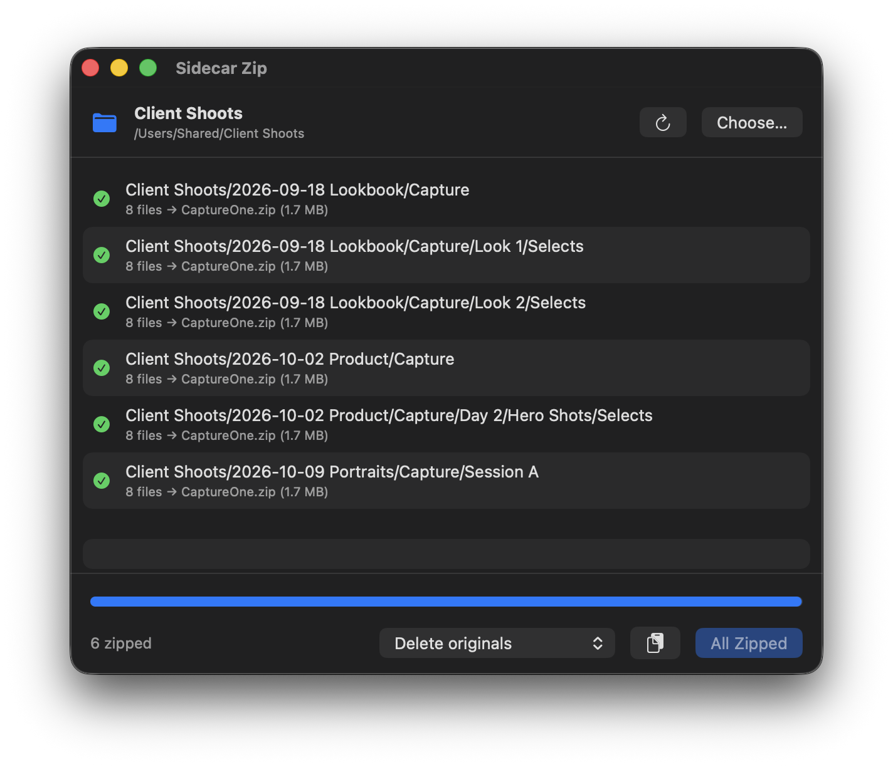
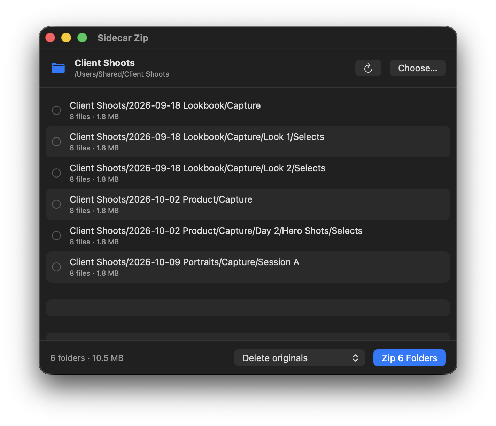

# Sidecar Zip

A small Mac app that zips up Capture One's `CaptureOne` sidecar folders, so your shoot archives are easier to back up, sync and hand off.



## Why

Capture One puts a `CaptureOne` folder next to your raw files, packed with settings files, thumbnails and preview caches. Across a big archive that adds up to thousands of tiny files. Backups crawl, cloud sync chokes, and copying to a client drive takes forever. Zip each one into a single `CaptureOne.zip` and the problem goes away. When you want to work on that shoot again, unzip it.

I used to do this with a one-liner in Terminal:

```sh
find /path/to/shoots -type d -name "CaptureOne" -exec sh -c 'cd "$(dirname "{}")" && zip -r "CaptureOne.zip" "CaptureOne" && rm -rf "CaptureOne"' \;
```

It worked, but you couldn't see anything. No list of what it found, no progress, and if something broke halfway you'd have to go digging. So I turned it into an app.

## What it does

Drop a folder on the window or the Dock icon. Sidecar Zip searches every subfolder, as deep as they go, and lists each `CaptureOne` folder with its file count and size. Nothing changes until you hit Zip.



Then it works through the list one folder at a time:

- Zips each folder in place to `CaptureOne.zip`, same as the old script
- Tests every zip before it touches the original folder
- Deletes the originals, moves them to the Trash, or leaves them alone. Your pick.
- Shows progress for each folder and for the whole run
- Puts any error on the row it belongs to and keeps going with the rest. Retry one folder or all the failed ones.
- Cancel (or Esc) stops right away and leaves the current folder untouched
- Copies a plain-text report of the run if you need to send it to someone
- Keeps your Mac awake while it runs

## Download

Grab the latest zip from [Releases](https://github.com/BVG-Digital/capture-one-sidecar-zip/releases), unzip it and drag **Sidecar Zip** into Applications.

The app isn't signed with an Apple Developer ID, so macOS blocks it the first time you open it. Open System Settings > Privacy & Security, scroll down and click **Open Anyway**. Or in Terminal:

```sh
xattr -dr com.apple.quarantine "/Applications/Sidecar Zip.app"
```

You need macOS 14 Sonoma or later. It runs on Apple Silicon and Intel.

## Getting a session back

Double-click `CaptureOne.zip` to unzip it in place, and Capture One picks up your edits like before. Unzip it before you browse to that folder in Capture One. If you don't, Capture One builds a fresh `CaptureOne` folder and you won't see your adjustments.

## Building it yourself

You need Xcode or the Command Line Tools.

```sh
git clone https://github.com/BVG-Digital/capture-one-sidecar-zip.git
cd capture-one-sidecar-zip
./build.sh
```

The app lands in `build/`. For quick testing you can also use `swift run`.

The icon comes from an SF Symbol. To swap it, pass a different symbol name and rebuild:

```sh
swift scripts/make-icon.swift shippingbox.fill && ./build.sh
```

## License

MIT. See [LICENSE](LICENSE).
